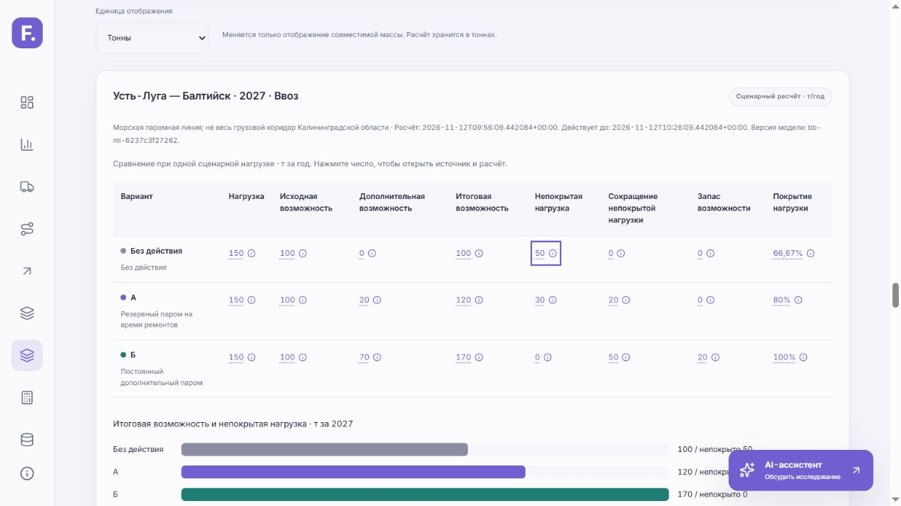

# FloCast: результат интеграции сравнения решений

Дата: 12 ноября 2026 года. Рабочая ветка: `integration/main-devops`.
Изменения оставлены в рабочей копии, без commit, push и публикации.
Предшествующие незавершённые изменения сохранены. Пользовательский `.env`
не редактировался; новые зависимости и изменения lock-файлов для этой задачи не требовались.

## Семь функций

| Функция | Фактический результат |
|---|---|
| Сравнить решения | Рабочая React-форма, серверное сравнение базы, А `reserve_ferry` и Б `additional_ferry`; таблица и график одного снимка. А+Б не рассчитывается. |
| При каких условиях этого достаточно? | Серверный порог, ограниченная численная сетка чувствительности, граница покрытия, выбор ячейки и её паспорт. |
| Паспорт каждой цифры | Паспорта входов, результатов, пороговой сетки и профиля направлений; определения, происхождение, формулы, единицы и состояние проверок. Диалог доступен с клавиатуры. |
| Ввоз и вывоз | Общая шкала, история 2015–2023 и прогноз из 2023, годовая таблица, сумма, доли, разность и отношение. Производные считает сервер. |
| Матрица покрытия | Восемь позиций трёх территорий, семь раздельных стадий, источники и ограничения. Матрица раскрывается рядом с формой. |
| Подготовить обоснование | Печатный HTML, CSV и JSON из существующего снимка; отчёт работает без ответа LLM. Печать вызывает системный диалог, автоматический PDF не заявляется. |
| Ассистент сравнения | Дополнительная вкладка существующей AI-панели, пять быстрых вопросов, обычный вопрос по снимку и отдельный подробный разбор тремя специализированными LLM-вызовами. |

Обычный чат, карта, утверждённый React, обе темы, старый калькулятор, прогнозы
и отдельные синтетические примеры сохранены. Пошаговый режим демонстрации для жюри не добавлялся.

## Пользовательский путь и согласованность

Открыть `/#compare`, раскрыть матрицу покрытия при необходимости, выбрать год
и направление. Ввести нагрузку непосредственно либо выбрать прогноз как масштаб
нагрузки и ввести множитель. Задать исходную возможность, приросты А/Б и происхождение
каждого допущения. При необходимости включить профиль двух направлений до расчёта.
После сравнения доступны таблица, график, порог, паспорта, экспорт и AI-пояснение.

Сервер создаёт неизменяемый `comparison_id` и хранит проверенный снимок до 30 минут,
максимум 128 записей на процесс. Используется один worker. Снимок фиксирует вход,
охват, период, результаты, источники, версии, SHA-256 идентичности модели и
канонического прогнозного контекста. Замена содержимого под прежними именами
версий также обнаруживается. Истечение/перезапуск возвращает 410, смена контекста — 409.
Кэш не является постоянным хранилищем.

Редактирование отменяет запросы, очищает связанный результат и отключает экспорт/AI
до нового расчёта. Запоздавшие ответы отбрасываются. Отдельная загрузка профиля также
отменяется при смене территории. Единица отображения меняет только масштаб чисел.
Актуальность применённого снимка проверяется также при возвращении фокуса и раз в 15 секунд.

Экспорт и ассистент принимают идентификатор; расчётным числам браузера сервер
не доверяет. Экспорт не выполняет повторный сценарный расчёт. JSON содержит
полные паспорта; HTML — компактные паспорта ключевых чисел. Исходная история,
архивы, внутренние пути и персональные данные проверяющих в распространяемый
отчёт не включаются. CSV имеет UTF-8 BOM и защиту текстовых ячеек от формул;
HTML экранирует пользовательский текст. При блокировке отдельного окна HTML
скачивается с понятной инструкцией открытия.

## Изменённые файлы

| Группа | Файлы этой реализации |
|---|---|
| Снимок и расчёты | `backend/schemas/comparison.py`, `backend/comparisons.py`, `backend/api/v1/comparisons.py` |
| Происхождение и покрытие | `backend/decision_evidence.py`, `backend/api/v1/decision_evidence.py` |
| AI и экспорт | `backend/decision_analysis.py`, `backend/decision_export.py`, `backend/api/v1/decision_assistant.py`, `backend/api/v1/decision_exports.py` |
| Интеграция сервера | `backend/app.py`, `backend/api/router.py`, `backend/llm_policy.py`, `backend/infrastructure/llm_client.py`, `backend/adapters/llm.py`, `backend/use_cases/llm.py` |
| React | `frontend/src/DecisionWorkspace.tsx`, `frontend/src/DecisionWorkspace.css`, `frontend/src/comparison-api.ts`, `frontend/src/App.tsx` |
| Проверки | `backend/tests/test_comparisons.py`, `test_decision_evidence.py`, `test_decision_analysis.py`, `test_decision_export.py` в той же папке; `frontend/tests/decision-dom.mjs`, `frontend/tests/decision-workspace.test.mjs`, `scripts/smoke_decisions.py` |
| Документация | `README.md`, `docs/contracts.md`, `docs/api_contract.md`, `docs/architecture.md`, `docs/decision-workspace.md`, этот отчёт |
| Подтверждение интерфейса | `docs/screenshots/decision-comparison.png` — синтетический ввод 150/100/20/70 |

Остальные изменения, видимые в общем Git diff, могли существовать до этой задачи.

## Публичные контракты

Все новые пути относительно фактического `BB_API_PREFIX`, получаемого React через `/config.json`:

| Метод | Путь | Назначение |
|---|---|---|
| POST | `/comparisons` | Проверить вход, вычислить варианты/пороги, создать снимок |
| GET | `/comparisons/{comparison_id}` | Получить актуальный снимок |
| GET | `/direction-profile` | Сопоставимые направления и производные |
| GET | `/coverage` | Фактические стадии готовности данных |
| GET | `/comparisons/{comparison_id}/export?format=html\|csv\|json` | Отчёт и выгрузки |
| POST | `/comparisons/{comparison_id}/ask` | Один вопрос по применённому снимку |
| POST | `/comparisons/{comparison_id}/analysis` | Подробный специализированный разбор |
| POST | `/comparisons/{comparison_id}/analysis/cancel` | Отменить разбор без нового платного вызова |

Входные и выходные поля описаны в разделе v0.19 `docs/contracts.md`;
маршруты и входные схемы также доступны в OpenAPI.
Существующие публичные схемы прогнозов, калькулятора и обычного чата сохранены.
Во внутренний LLM-порт добавлен необязательный keyword `system_prompt`, позволяющий
передать фиксированную системную роль; старые вызовы без него сохраняют поведение.

## Проверки и их границы

| Проверка | Результат |
|---|---|
| Полный `backend/tests` | **236 passed, 3 skipped**, одна существующая Starlette/httpx deprecation warning |
| Frontend: новые активные React-компоненты и выбранные существующие тесты API, ассистента, отчёта и географии | **21 passed**, в том числе пять DOM-тестов нового рабочего раздела |
| TypeScript | `tsc -b frontend/tsconfig.json` — пройден |
| ESLint | `npm --prefix frontend run lint` — пройден |
| Ruff | Backend и оба HTTP smoke-скрипта — пройден |
| HTTP | Старый `smoke.py` и новый `smoke_decisions.py`, сервер 127.0.0.1:8011 без LLM — пройдены |
| Браузер | Реальный React → HTTP API → таблица 50/30/0 и запас 20; паспорт/Escape/фокус, направления, CSV, HTML, единицы, неподдерживаемая территория, обе темы, мобильная форма 390×844 |
| Неизменность артефактов | SHA-256 **124** ранее существовавших файлов моделей, блокировок и сохранённых blind-результатов: **0 изменений** |

Арифметические проверки включают нули, равные варианты, запас, отрицательные,
неконечные и предельные значения. Проверяются несовместимый срез, отсутствие модели,
происхождение, истечение, замена версии и замена содержимого под прежними версиями,
неизменность снимка, согласованность паспортов/экспорта и защита HTML/CSV.
LLM проверялся подменённым провайдером: успех, частичные и полные отказы, таймаут,
отмена/disconnect, дубль, лимиты, неверный JSON, неизвестные ссылки, prompt injection,
повторный HTTP-разбор и отсутствие настроек. Реальная платная модель не вызывалась.

Три штатных real-model теста пропущены без `RUN_REAL_MODEL_TESTS=1`: обычный
набор проверяет синтетический временный артефакт. Замороженные модели не обучались,
закрытые blind-наблюдения повторно не открывались, блокировки не снимались.
ML/ETL-модули этой задачей не изменялись и их эксперименты не пересчитывались.

Средовые ограничения Windows:

- Обычная Vite production-сборка и полный стандартный frontend runner блокируются
  запретом Node `ChildProcess.spawn`: `spawn EPERM` при запуске esbuild/worker.
  Это не выдаётся за успешную проверку штатной Vite/PWA-цепочки.
- Для браузерной проверки создана отдельная проверочная production-сборка объявленным
  native `esbuild.exe`, с PostCSS/Tailwind и штатными source/index SHA-256.
  PWA/service-worker стадия Vite таким способом не проверена. Исходники и обычные
  build-команды не заменены; зависимости и настройки защиты не менялись.
- Выбранные frontend-тесты выполнены без изоляционных дочерних процессов;
  новые DOM-тесты используют установленный TypeScript в текущем процессе.
  Старые DOM-тесты, требующие дочернего esbuild, в этой среде полностью не выполнены.
- Pytest использовал временную Windows-обвязку `os.mkdir`: mode 0700 заменён на
  0777 при создании временных тестовых папок, поскольку sandbox иначе запрещает
  чтение созданной папки. Код приложения и условия проверок не подменялись.
- HTML проверен на кириллицу, таблицы и отсутствие переполнения. Нажатие печати
  вызвало блокировку браузерной команды до Escape; итоговую системную PDF-пагинацию
  и сохранение PDF нужно проверить человеком в обычном браузере. Автоматический PDF не заявляется.

## Запуск

Из корня проекта, в существующем проверенном окружении:

```powershell
npm --prefix frontend run build
.\.cache\venv311\Scripts\python.exe -m uvicorn backend.app:app --reload
```

Основной адрес: `http://127.0.0.1:8000/#compare`.
Для разработки отдельно: `npm --prefix frontend run dev`.
Проверка запущенного API:

```powershell
.\.cache\venv311\Scripts\python.exe scripts/smoke.py
.\.cache\venv311\Scripts\python.exe scripts/smoke_decisions.py
```

`--expect-llm-disabled` следует добавлять только для сервера без провайдера.
В ходе реализации для HTTP/браузерной проверки использовался отдельный процесс
8011 с LLM, отключённым параметрами процесса, без изменения `.env`.
Наличие проверочной сборки не означает, что штатный `npm run build` прошёл в sandbox.

## Runtime-субагенты и отказы

`comparison_analyst` объясняет арифметику и различия, `evidence_analyst` выделяет
происхождение и пропуски, `assumption_reviewer` рассматривает условия смены вывода.
Каждый получает отдельный LLM-вызов, фиксированную системную роль и ограниченный
контекст того же снимка. Синтез детерминированный: **не более трёх вызовов** на разбор,
без дополнительного LLM-синтеза. Обычный вопрос — один вызов.

Максимум два LLM-вызова одновременно, общий таймаут 60 секунд, контекст до 24000
символов, ответ специалиста до 12000, ограниченные списки. Дополнительно действуют
серверные лимиты частоты/доступа/токенов существующего клиента. Нет рекурсий,
инструментов, файлового доступа, внешнего поиска и автоматических повторов.
Проверяются JSON, ссылки на разрешённые поля/источники и числовые подстановки
из серверных значений; это не доказывает истинность свободного текста.
Дубликат отклоняется, отмена завершает дочерние задачи, отказ специалиста помечается
как частичный результат. Разногласия, допущения и ограничения сохраняются.

Без LLM продолжают работать сравнение, пороги, паспорта, доступные направления,
матрица и все экспорты. Без модели работают прямой сценарный ввод, пороги,
паспорта и экспорт; модельные срезы явно недоступны. Синтетика не подставляется
при ошибке реальной модели. Для других территорий/видов не создаются результаты.

## Открытые решения и человеческая проверка

По-прежнему требуются подтверждённая нагрузка/провозная возможность, применимая
выработка судов, ремонтный календарь, инфраструктурные ограничения, CAPEX/OPEX,
критерий выбора и совместимость А+Б. Их отсутствие не превращается в ноль.
История относится к конкретной линии, не ко всему коридору; 2024–2030 остаются
прогнозом из 2023. Не заявляются точность до 2030, гарантированное покрытие
интервалов, причинный эффект инвестиции или доказанные порожние обратные рейсы.

ИИ участвовал в проектировании контрактов, реализации, тестах и документации;
параллельные агенты разрабатывали независимые части. Ведущий агент выполнил
интеграцию, повторные проверки и браузерный сценарий. Это машинная проверка,
**не человеческая приёмка**. Команде необходимо предметно сверить источники,
подтвердить реальные параметры действий, оценить ответы настроенного провайдера,
проверить штатный Vite/PWA build вне sandbox и сохранение печатного отчёта в PDF.


